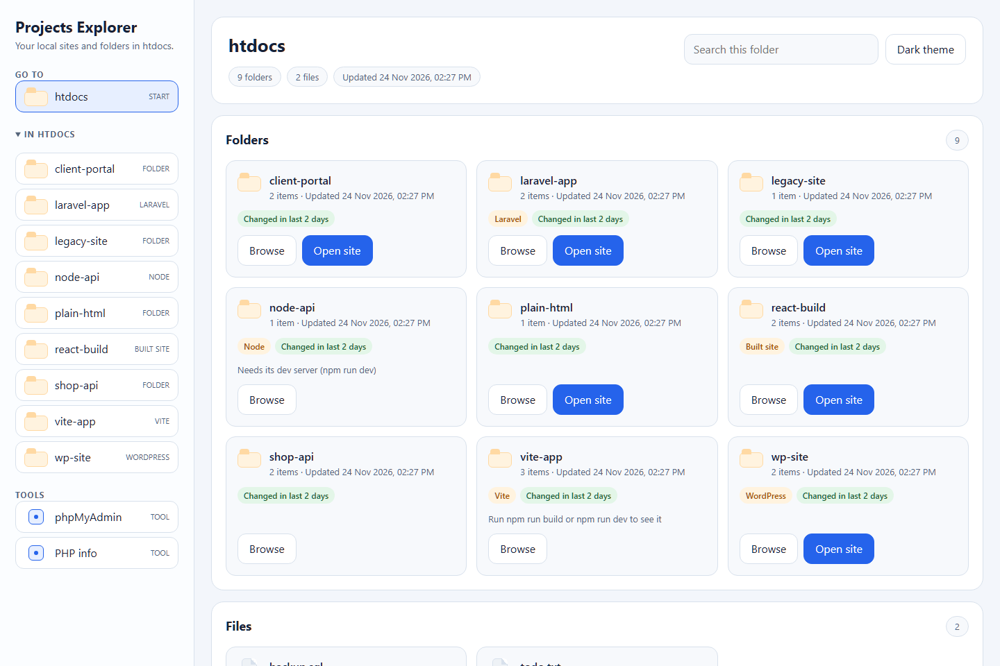

# Projects Explorer

A replacement for the XAMPP dashboard. When you open `http://localhost/`, you see the folders in your `htdocs` as a file browser, with an **Open site** button on every project instead of the Apache Friends welcome page.

It works with any folder layout. You don't need to reorganise anything.



## What it does

- Lists the folders and files in `htdocs`, folders first, with breadcrumbs and a search box.
- Opens on `htdocs/Projects` if you have that folder, otherwise on `htdocs` itself. You can pick any start folder in the settings.
- Works out what each project is, so **Open site** goes to the right place:

  | Project | How it's spotted | Open site goes to |
  | --- | --- | --- |
  | Laravel | `artisan` and `public/index.php` | `public/` |
  | WordPress | `wp-config.php` | the folder |
  | Vite | `vite.config.*` | `dist/` if built, otherwise a note to run the dev server |
  | Plain PHP or HTML | `index.php`, `index.html`, `index.htm`, `default.php`, `default.html` | the folder (or the `default.*` file) |
  | Built front-end | `dist/index.html` or `build/index.html` | `dist/` or `build/` |
  | Node | `package.json` with no page to open | no button, a note to run the dev server |

- Hides XAMPP's own folders, dotfiles (`.git`, `.env`), `node_modules` and `vendor`.
- Lists files that often hold secrets (`.sql`, `.env`, `.key`, `.pem`, `.log`, `.bak`) without an open link.
- Marks folders changed in the last two days or the last week.
- Light and dark theme. It follows your system setting until you pick one.
- Only answers requests from your own computer (see [Safety](#safety)).
- Works with a keyboard and on small screens.

No libraries, no Composer, no build step. Plain PHP, CSS and JavaScript.

## Requirements

- XAMPP with PHP 8.0 or newer. Every XAMPP release since 2021 has this.
- Windows for the one-click installer. macOS and Linux work too, with a manual copy (below).

## Install on Windows

1. Download this project: open the latest release on the **Releases** page and download the zip, or use **Code**, then **Download ZIP**.
2. Unzip it anywhere, for example your Downloads folder.
3. Double-click `install.bat`.
4. Open `http://localhost/` in your browser.

The installer:

- finds XAMPP on any drive (it asks for the path if XAMPP isn't in a usual place)
- saves XAMPP's own dashboard page as `dashboard\index.php.original`, once, and never overwrites that copy
- copies `index.php` and the `explorer` folder into `xampp\htdocs\dashboard\`
- leaves your settings file alone

If the installer can't find XAMPP, run it from a Command Prompt with the path: `install.bat "D:\xampp"`.

## Install on macOS or Linux

The dashboard folder is:

- macOS: `/Applications/XAMPP/xamppfiles/htdocs/dashboard`
- Linux: `/opt/lampp/htdocs/dashboard`

In a terminal, from the unzipped project folder (replace the path with yours):

```sh
DASH=/Applications/XAMPP/xamppfiles/htdocs/dashboard
sudo cp -n "$DASH/index.php" "$DASH/index.php.original"   # keep XAMPP's page, only the first time
sudo cp index.php "$DASH/"
sudo cp -R explorer "$DASH/"
```

## Settings

Everything works without settings. To change something:

1. Go to `xampp\htdocs\dashboard\explorer\`.
2. Copy `config.example.php` to `config.php`.
3. Edit `config.php`. You only need to keep the lines you change.

Updates never overwrite `config.php`.

| Setting | Default | What it does |
| --- | --- | --- |
| `start` | `'auto'` | Folder to open first, inside htdocs, e.g. `'work/clients'`. `'auto'` opens `Projects` if it exists, otherwise htdocs. |
| `pinned` | `[]` | Folders listed at the top of the sidebar, e.g. `['work/clients', 'blog']`. |
| `hide_in_root` | XAMPP's files | Names hidden in the htdocs folder only. |
| `hide_everywhere` | `node_modules`, `vendor` | Names hidden in every folder. |
| `show_dotfiles` | `false` | Show names that start with a dot. |
| `no_link_patterns` | `.env*`, `*.sql` and others | Files listed without an open link. `*` is a wildcard. |
| `tools` | phpMyAdmin, PHP info | Links in the sidebar's Tools list. |
| `allow_remote` | `false` | Let other computers open the dashboard. |
| `root` | `'auto'` | The folder Apache serves at `http://localhost/`. Only change this if the dashboard can't find it. |
| `title` | `'Projects Explorer'` | Name in the sidebar and browser tab. |

Example `config.php`:

```php
<?php
return [
    'start'  => 'work',
    'pinned' => ['work/clients', 'personal/blog'],
];
```

## Safety

- **Local only.** The dashboard lists every folder in htdocs, so it refuses requests that don't come from your own computer. If your Apache can be reached from your network, other people get a "not allowed" page. Set `allow_remote` to `true` only if you're sure.
- **No links to secret files.** `.env`, `.sql` dumps and similar files are listed without a link. This only affects the dashboard. Apache still serves any file in htdocs to anyone who knows its address, so keep real secrets and database dumps out of htdocs, or block them in your Apache settings.
- **Stays inside htdocs.** Folder paths are checked, so `?path=../..` can't reach anything outside htdocs.
- **Read-only.** The dashboard never changes, moves or deletes files.

## Updating

Download the new version and run `install.bat` again. Your `config.php` and the saved XAMPP page are kept.

Coming from version 1? Run the new `install.bat` the same way. It finds the original XAMPP page that version 1 saved as `index.php.bak` and keeps it as `index.php.original`. Version 1 also created an empty `htdocs\Projects` folder; you can delete it if you don't use it.

## Uninstalling

- Windows: double-click `uninstall.bat`. It puts XAMPP's page back, removes the `explorer` folder, and keeps your settings as `dashboard\projects-explorer-config.php`.
- macOS or Linux: copy `index.php.original` back over `index.php` in the dashboard folder and delete the `explorer` folder.

## Licence

MIT. See [LICENSE](LICENSE).
